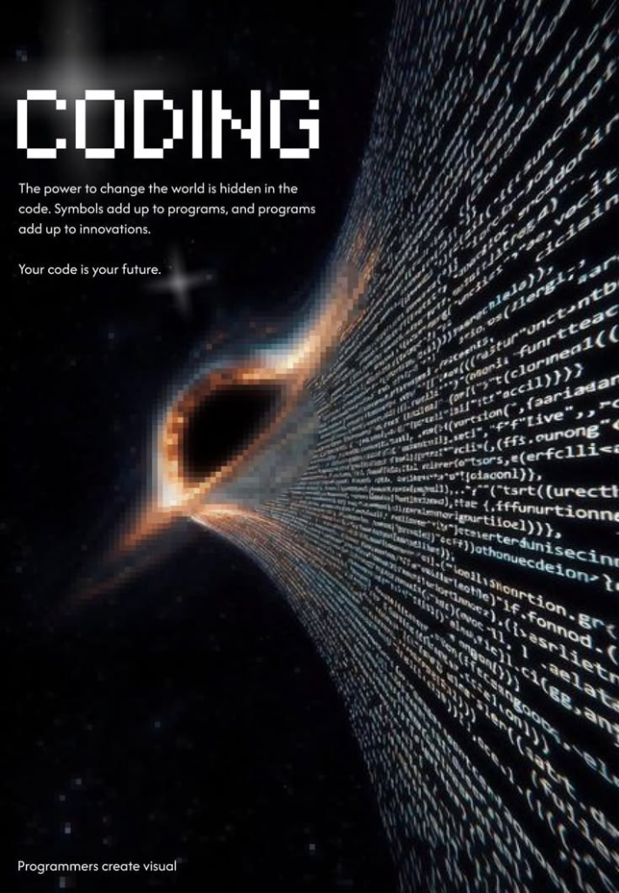
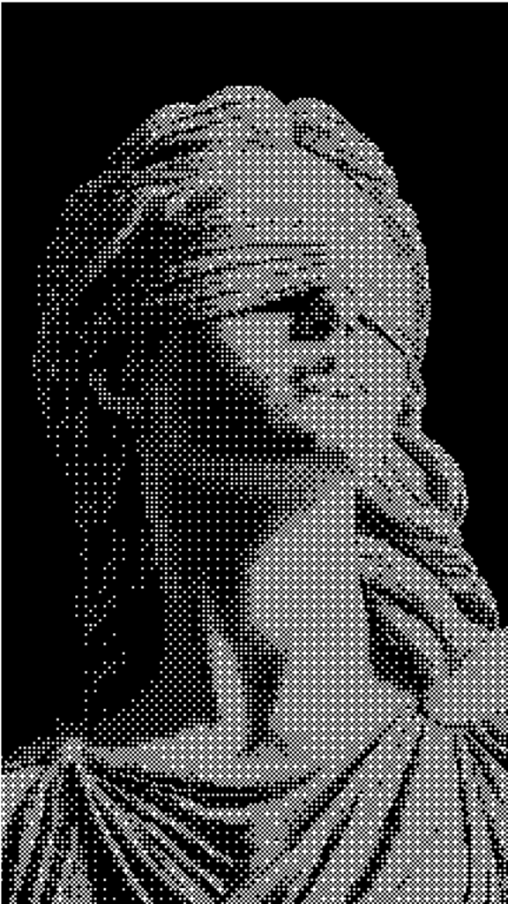
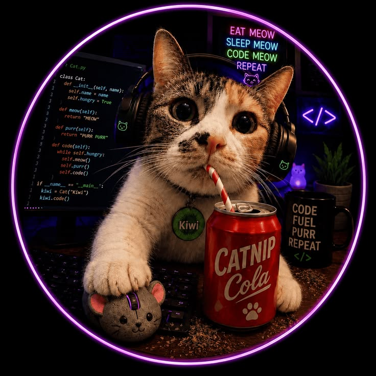

  <!-- BANNER HEADER CON EFECTO ONDULADO Y GRADIENTE OSCURO -->
  

  <!-- EFECTO TYPING ANIMADO EN TIEMPO REAL -->
  

   

  <!-- BADGES DE CONTACTO Y REDES SOCIALES -->
  

    
    
    
    
  

---

### 👨‍💻 Sobre mí / About Me

<table>
  <tr>
    <td width="65%" valign="top">

- 🎓 **Enfoque Académico:** Ciencias de la Computación / Ingeniería de Sistemas enfocado en **Estructuras de Datos y Algoritmos**.
- ⚙️ **Stack Principal:** **C++**, **C**, **TypeScript** y **Python**.
- 🛠️ **Proyectos Recientes:**
  - 🧩 Implementación de **Estructuras de Datos** avanzadas (*Listas Secuenciales, Árboles, Grafos, Colecciones*).
  - 🤖 Automatización de flujos de trabajo (*Workflow Automation*) e integración con IA.
- 🚀 **Logros en GitHub:** Reconocido con insignias **Pull Shark** 🦈 y **Yolo** 🚀.
- 🎯 **Objetivo:** Diseñar software robusto, arquitecturas limpias y sistemas de alto rendimiento.
- 💡 **Filosofía:** *"The power to change the world is hidden in the code. Symbols add up to programs, and programs add up to innovations."*

  </td>
  <td width="35%" align="center" valign="middle">
    <!-- FOTO 1: ARTE DE CIRCUITOS TECH -->
    
     
    <b>Logic • Circuits • Architecture</b>
  </td>
</tr>
</table>

---

### 🛠️ Lenguajes & Tecnologías (Tech Arsenal)

| Categoría | Tecnologías y Herramientas |
| :--- | :--- |
| **Lenguajes Core** |  |
| **Estructuras & Frameworks** |  |
| **Herramientas & Entorno** |  |

---

### 🌌 Filosofía de Código & Innovación

  <!-- FOTO 2: VÓRTICE DE CÓDIGO -->
  
   
  <i>"Your code is your future. Programmers create visual tomorrow."</i>

---

### 📊 Estadísticas de GitHub en Tiempo Real (`steven9tp`)

  <!-- TARJETA DE ESTADÍSTICAS PRINCIPALES -->
  

  <!-- RACHA DE ACTIVIDAD (STREAK STATS) -->
  

    

  <!-- LENGUAJES MÁS UTILIZADOS -->
  

---

### 🏛️ Rincón Estético & Resolución de Problemas

  <table>
    <tr>
      <td align="center" width="50%">
        <!-- FOTO 3: ESTATUA 1-BIT DITHERED -->
        
         
        <b>Classical Logic • 1-Bit Aesthetics</b>
      </td>
      <td align="center" width="50%">
        <!-- FOTO 4: GATITO PROGRAMADOR -->
        
         
        <b>Eat • Sleep • Code • Repeat</b>
      </td>
    </tr>
  </table>

---

  
<b>⚡ steven9tp • Construyendo el futuro línea por línea</b>

  

